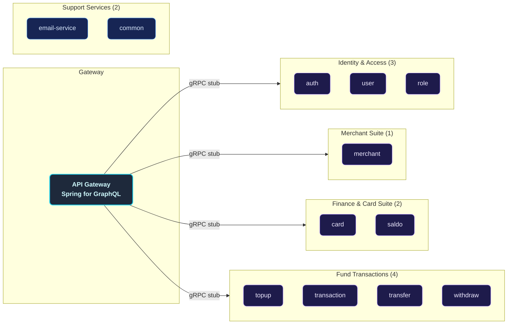
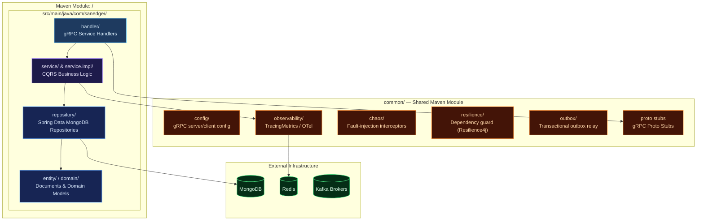
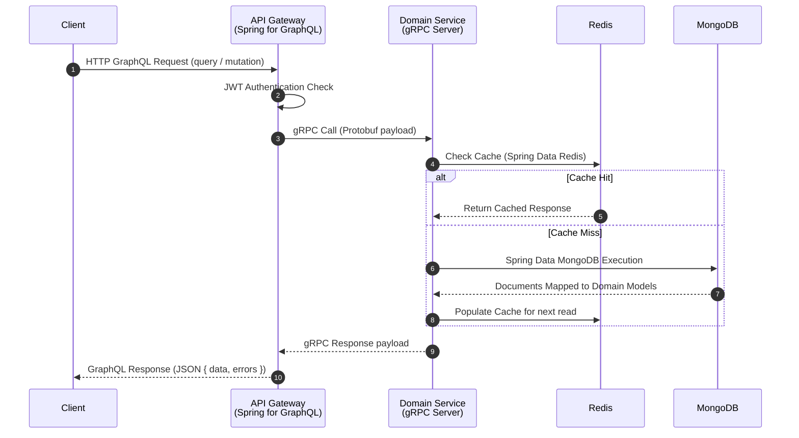
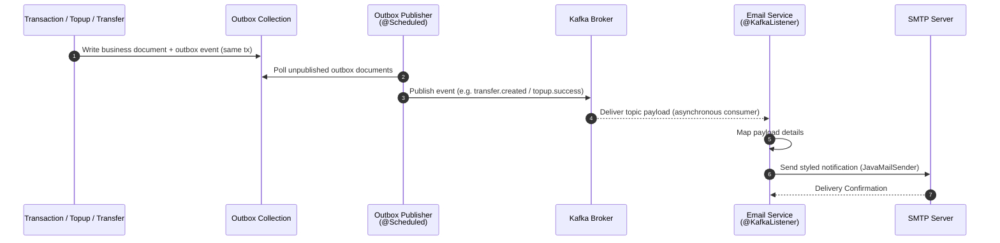
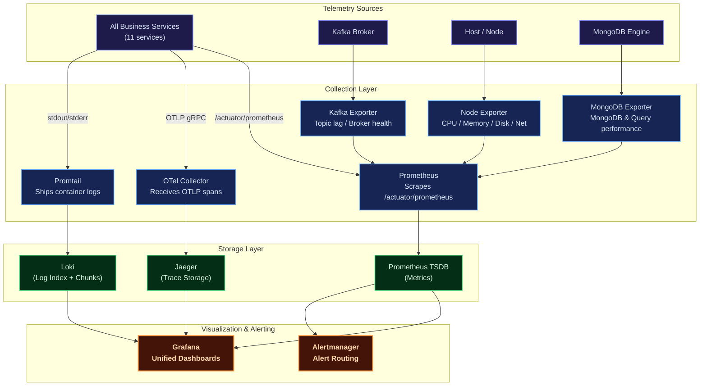
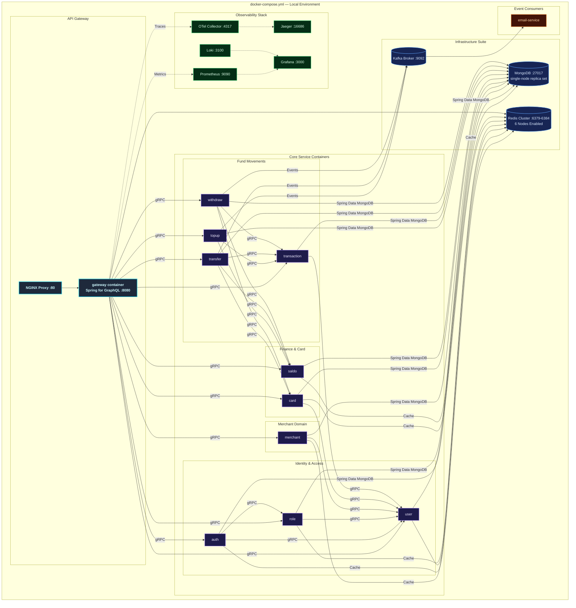

# Distributed Modular Monolith — Payment Gateway Platform (Spring Boot)

A production-grade, highly resilient, and fully observable **modular-monolith payment gateway backend** built in **Java 21** using **Spring Boot 3.5.6**. Designed around domain-driven service boundaries following Clean Architecture and CQRS principles, it retains the operational and deployment simplicity of a single deployment unit while maintaining the logical isolation typical of microservices.

Each financial and identity business domain — Users, Roles, Cards, Merchants, Saldo, Topups, Transactions, Transfers, Withdrawals — lives in its own self-contained Maven module. These modules communicate synchronously via high-performance **gRPC** protocols and asynchronously using **Apache Kafka** event propagation, exposing a unified **GraphQL** entry point through a **Spring for GraphQL** gateway.

The platform is fortified with a **comprehensive observability suite** (Prometheus, Grafana, Loki, Jaeger, OpenTelemetry), Spring Data MongoDB's built-in connection pooling, **distributed Redis caching** with custom telemetry for each service, and Kubernetes configurations ready for production auto-scaling.

---

## Key Features

| Domain | Capabilities |
| :--- | :--- |
| **Auth & Users** | Secure registration, stateless JWT access/refresh token lifecycle, password reset workflows, OTP email verification, and a `me` profile GraphQL query. |
| **Roles & RBAC** | Custom permission configuration, granular access control matrices, and sub-second permission evaluation cached via Redis. |
| **Cards & VCC** | Virtual and debit card CRUD operations with soft-delete capabilities, card activation/suspension toggles, and multi-dimensional transaction analytics (daily/monthly/yearly topup, withdraw, transfer). |
| **Merchants** | Fully featured merchant onboarding, profile details management, business data registration, and merchant performance/transaction reports with full data restoration capabilities (soft delete & restore). |
| **Saldo (Balance)** | High-throughput, thread-safe real-time balance calculations, optimistic concurrency locks, and localized balances. |
| **Topup** | Balance loading ledger engine supporting multiple payment methods, detailed transactions logging, and soft-delete audit records. |
| **Transaction** | Centralized financial audit ledger collecting transaction events across the system, global search filters, status tracking, and monthly/yearly volume reports. |
| **Transfer** | Safe peer-to-peer card-to-card or user-to-user funds settlement with balance debit/credit synchronization and event-driven logging. |
| **Withdraw** | Funds settlement from user cards to external accounts/banks, daily transaction threshold limits, and status processing pipelines. |
| **Email Worker** | Kafka-driven asynchronous worker dispatching critical notification emails (OTPs, login alerts, merchant onboarding notices, and transfer/topup invoices) via SMTP. |
| **Observability** | Multi-dimensional metrics (Prometheus + Grafana), log aggregation (Loki + Promtail), end-to-end distributed tracing (Jaeger + OpenTelemetry), and resource monitors (Node, Kafka, MongoDB Exporters). |
| **Deployment** | Local orchestration using Docker Compose (featuring a 6-node Redis Cluster and a single-node MongoDB replica set), and auto-scaling Kubernetes manifests configured with Horizontal Pod Autoscalers (HPA). |

---

## Architecture Overview

The platform implements a **Distributed Modular Monolith** architecture. Each business service is logical, decoupled, and self-contained inside its own Maven submodule, possessing its own independent gRPC boundary. A **Spring for GraphQL gateway** acts as the unified edge router, resolving client GraphQL operations into fast gRPC downstream calls via generated gRPC stubs.

### Core Architecture Principles

- **Domain-Driven Boundary Isolation**: Every service owns its database access, caching layers, and service logic, strictly forbidding cross-boundary database sharing.
- **Clean Architecture & CQRS**: Separation of concerns using `Handler (gRPC) → Service (Command/Query) → Repository (Command/Query)` layers ensures business logic remains clean, performant, and framework-agnostic.
- **Spring-managed execution**: Backed by Spring Boot auto-configuration — `GrpcServerLifecycle` starts a shaded-Netty gRPC server, Spring Data MongoDB/Redis manage persistence and caching, and Spring Kafka drives the outbox relay.
- **MongoDB Driver Pooling**: Spring Data MongoDB manages a per-service connection pool, avoiding socket exhaustion across the multiple concurrent modular services.
- **Event-Driven Resilience**: Apache Kafka decouples transaction events (via the transactional outbox pattern), ensuring side effects like email billing remain completely non-blocking.
- **OTel Telemetry Integration**: Micrometer Tracing + the OpenTelemetry OTLP exporter inject trace IDs across gRPC boundaries, allowing seamless trace propagation from the GraphQL gateway down to MongoDB operations.

```mermaid
graph TB
    classDef client fill:#0f172a,stroke:#38bdf8,color:#e0f2fe,stroke-width:2px,font-weight:bold
    classDef gateway fill:#1e293b,stroke:#22d3ee,color:#cffafe,stroke-width:2px,font-weight:bold
    classDef domain fill:#1e1b4b,stroke:#818cf8,color:#e0e7ff,stroke-width:1.5px
    classDef infra fill:#172554,stroke:#60a5fa,color:#dbeafe,stroke-width:1.5px
    classDef obs fill:#052e16,stroke:#4ade80,color:#dcfce7,stroke-width:1.5px
    classDef event fill:#431407,stroke:#fb923c,color:#fed7aa,stroke-width:1.5px

    Client["Client Applications<br/>(Web / Mobile / API)"]:::client

    subgraph APIGateway["API Gateway — NGINX + Spring for GraphQL"]
        direction LR
        GQL["GraphQL Endpoint<br/>/graphql — Port :8080"]:::gateway
        AuthMW["JWT Auth & Role<br/>WebGraphQlInterceptor"]:::gateway
    end

    Client -->|"HTTP GraphQL"| APIGateway

    subgraph BusinessServices["Business Domain Services (Java · Spring Boot)"]
        direction TB

        subgraph IdentityDomain["Identity & Access"]
            AUTH["Auth Service<br/>JWT & BCrypt Server"]:::domain
            USER["User Service<br/>Profile Management"]:::domain
            ROLE["Role Service<br/>RBAC & Permissions"]:::domain
        end

        subgraph MerchantDomain["Merchant Management"]
            MERCH["Merchant Service<br/>Onboarding & Profiling"]:::domain
        end

        subgraph FinanceDomain["Finance & Ledger Suite"]
            CARD["Card Service<br/>VCC & Card Analytics"]:::domain
            SALDO["Saldo Service<br/>Real-time Balance Tracker"]:::domain
        end

        subgraph TransactionDomain["Transfers & Transactions"]
            TOPUP["Topup Service<br/>Balance Funding Engine"]:::domain
            TXN["Transaction Service<br/>Central Audit Register"]:::domain
            TRANSFER["Transfer Service<br/>P2P Card-to-Card Transfer"]:::domain
            WITHDRAW["Withdraw Service<br/>Outbound Fund Settlement"]:::domain
        end
    end

    GQL -->|"gRPC stub (@Value host:port)"| AUTH
    GQL -->|"gRPC stub"| USER
    GQL -->|"gRPC stub"| ROLE
    GQL -->|"gRPC stub"| MERCH
    GQL -->|"gRPC stub"| CARD
    GQL -->|"gRPC stub"| SALDO
    GQL -->|"gRPC stub"| TOPUP
    GQL -->|"gRPC stub"| TXN
    GQL -->|"gRPC stub"| TRANSFER
    GQL -->|"gRPC stub"| WITHDRAW

    subgraph Infrastructure["Infrastructure Layer"]
        direction LR
        MONGO[("MongoDB<br/>example_mongo_payment_gateway DB")]:::infra
        REDIS[("Redis<br/>Distributed Cache")]:::infra
        KAFKA[("Kafka Broker<br/>Event Bus")]:::infra
    end

    AUTH -->|"Spring Data MongoDB"| MONGO
    USER -->|"Spring Data MongoDB"| MONGO
    ROLE -->|"Spring Data MongoDB"| MONGO
    MERCH -->|"Spring Data MongoDB"| MONGO
    CARD -->|"Spring Data MongoDB"| MONGO
    SALDO -->|"Spring Data MongoDB"| MONGO
    TOPUP -->|"Spring Data MongoDB"| MONGO
    TXN -->|"Spring Data MongoDB"| MONGO
    TRANSFER -->|"Spring Data MongoDB"| MONGO
    WITHDRAW -->|"Spring Data MongoDB"| MONGO

    AUTH -->|"Spring Data Redis"| REDIS
    USER -->|"Spring Data Redis"| REDIS
    ROLE -->|"Spring Data Redis"| REDIS
    MERCH -->|"Spring Data Redis"| REDIS
    CARD -->|"Spring Data Redis"| REDIS
    SALDO -->|"Spring Data Redis"| REDIS
    GQL -->|"Spring Data Redis"| REDIS

    subgraph EventConsumers["Event-Driven Consumers"]
        EMAIL["Email Service<br/>SMTP Notification Worker"]:::event
    end

    KAFKA -->|"@KafkaListener"| EMAIL

    subgraph Observability["Observability Stack"]
        direction LR
        PROM["Prometheus<br/>Metrics Engine"]:::obs
        LOKI["Loki<br/>Log Aggregator"]:::obs
        JAEGER["Jaeger<br/>Distributed Traces"]:::obs
        GRAFANA["Grafana<br/>Unified Dashboards"]:::obs
        OTEL["OTel Collector<br/>Telemetry Pipeline"]:::obs
        PROMTAIL["Promtail<br/>Log Shipper"]:::obs
        NODEX["Node Exporter<br/>System Metrics"]:::obs
        KAFKAX["Kafka Exporter<br/>Broker Metrics"]:::obs
        PGX["MongoDB Exporter<br/>DB Performance"]:::obs
    end

    AUTH -->|gRPC| USER
    AUTH -->|gRPC| ROLE
    MERCH -->|gRPC| USER
    CARD -->|gRPC| USER
    TOPUP -->|gRPC| SALDO
    TOPUP -->|gRPC| TXN
    TRANSFER -->|gRPC| CARD
    TRANSFER -->|gRPC| SALDO
    TRANSFER -->|gRPC| TXN
    WITHDRAW -->|gRPC| CARD
    WITHDRAW -->|gRPC| SALDO
    WITHDRAW -->|gRPC| TXN

    AUTH -.->|"Outbox → Kafka"| KAFKA
    TOPUP -.->|"Outbox → Kafka"| KAFKA
    TRANSFER -.->|"Outbox → Kafka"| KAFKA
    WITHDRAW -.->|"Outbox → Kafka"| KAFKA

    AUTH -.->|"/actuator/prometheus"| PROM
    USER -.->|"/actuator/prometheus"| PROM
    ROLE -.->|"/actuator/prometheus"| PROM
    MERCH -.->|"/actuator/prometheus"| PROM
    CARD -.->|"/actuator/prometheus"| PROM
    SALDO -.->|"/actuator/prometheus"| PROM
    TOPUP -.->|"/actuator/prometheus"| PROM
    TXN -.->|"/actuator/prometheus"| PROM
    TRANSFER -.->|"/actuator/prometheus"| PROM
    WITHDRAW -.->|"/actuator/prometheus"| PROM
    GQL -.->|"/actuator/prometheus"| PROM

    AUTH -.->|"OTLP Spans"| OTEL
    USER -.->|"OTLP Spans"| OTEL
    ROLE -.->|"OTLP Spans"| OTEL
    MERCH -.->|"OTLP Spans"| OTEL
    CARD -.->|"OTLP Spans"| OTEL
    SALDO -.->|"OTLP Spans"| OTEL
    TOPUP -.->|"OTLP Spans"| OTEL
    TXN -.->|"OTLP Spans"| OTEL
    TRANSFER -.->|"OTLP Spans"| OTEL
    WITHDRAW -.->|"OTLP Spans"| OTEL
    GQL -.->|"OTLP Spans"| OTEL

    OTEL -.-> JAEGER
    PROMTAIL -.-> LOKI
    NODEX -.-> PROM
    KAFKAX -.-> PROM
    PGX -.-> PROM
    PROM -.-> GRAFANA
    LOKI -.-> GRAFANA
    JAEGER -.-> GRAFANA
    KAFKA -.-> KAFKAX
    MONGO -.-> PGX
```



---

## Service Catalog

The modular architecture consists of **12 logical micro-applications** plus supporting database and migrations:



| Module | Role | gRPC port |
| :--- | :--- | :--- |
| `gateway` | Spring for GraphQL edge (HTTP :8080) | — |
| `auth` | Authentication, JWT issuance | 9012 |
| `card` | Virtual/debit cards & analytics | 9004 |
| `merchant` | Merchant onboarding & reports | 9005 |
| `role` | RBAC & permissions | 9006 |
| `saldo` | Real-time balance ledger | 9007 |
| `topup` | Balance funding | 9008 |
| `transaction` | Central audit register | 9009 |
| `transfer` | P2P fund transfer | 9010 |
| `user` | User profiles | 9011 |
| `withdraw` | Outbound settlement | 9013 |
| `email-service` | Kafka-driven SMTP worker (HTTP :8092) | — |
| `db-migration` | Mongock migration runner (run-to-completion) | — |

---

## Internal Service Architecture

Every logical business service is mapped as a decoupled submodule following structured clean architecture rules.



---

## Data & Event Flow

### Synchronous Flow (GraphQL Resolver & Cache Read-Through)

All external client operations go through the GraphQL resolvers exposed by the Spring for GraphQL gateway. The gateway validates the JWT, invokes the correct downstream gRPC modular server through a generated stub, which checks Redis and falls back to MongoDB on a cache miss.



### Asynchronous Flow (Transactional Outbox → Kafka → Email)

High-performance transaction modifications (like transfers or top-ups) write an outbox document inside the same database transaction. A scheduled publisher drains the outbox to Apache Kafka; the isolated Email service consumes the topic via `@KafkaListener` and contacts SMTP.



---

## Observability Architecture



| Pillar | Tool | Purpose |
| :--- | :--- | :--- |
| **Metrics** | Prometheus + Grafana | Core metrics tracking (CPU, memory, request error rates, gRPC latencies, DB connection states) scraped from `/actuator/prometheus`. |
| **Logging** | Loki + Promtail | Centralized structured logger for indexing container logs by service, queryable via LogQL. |
| **Tracing** | OpenTelemetry + Jaeger | Distributed system tracing across the GraphQL gateway and internal gRPC services. |
| **Alerting** | Alertmanager | Automated notification system triggered during latency hikes or service disconnects. |

---

## Deployment Architectures

### Docker Compose (Local Development)

The Docker Compose stack provisions a 6-node Redis Cluster along with databases, event brokers, and service containers built directly from the per-module `Dockerfile`s. Each image is a multi-stage build (`maven:3.9-eclipse-temurin-21` build stage → `eclipse-temurin:21-jre-alpine` runtime).



> `deployments/local/docker-compose.yml` builds and runs the **full stack** (infra + all Java services from their Dockerfiles). To run the Java services on the host instead, start only the infrastructure containers from the same file (see the host-run alternative below) — the services read their connection settings from `deployments/local/host.env`.

---

### Kubernetes (Production Clustering)

The production-grade Kubernetes architecture is designed for high availability, fault tolerance, and seamless horizontal scaling. All manifests are defined inside the custom `payment-gateway` namespace, route edge traffic using NGINX pods acting as a LoadBalancer, and manage service scalability using individual HPAs.

```mermaid
flowchart TB
    classDef client fill:#0f172a,stroke:#38bdf8,color:#e0f2fe,stroke-width:2px,font-weight:bold
    classDef ingress fill:#0f172a,stroke:#06b6d4,color:#e0f7fa,stroke-width:2px,font-weight:bold
    classDef k8sSvc fill:#1e293b,stroke:#22d3ee,color:#cffafe,stroke-width:2px,font-weight:bold
    classDef pod fill:#1e1b4b,stroke:#a78bfa,color:#ede9fe,stroke-width:1.5px
    classDef stateful fill:#172554,stroke:#60a5fa,color:#dbeafe,stroke-width:1.5px
    classDef hpa fill:#064e3b,stroke:#34d399,color:#ecfdf5,stroke-width:1px,stroke-dasharray: 5 5
    classDef obs fill:#052e16,stroke:#4ade80,color:#dcfce7,stroke-width:1.5px

    Client["Client Applications<br/>(HTTPS Requests)"]:::client

    subgraph K8sCluster["Kubernetes Cluster — Namespace: payment-gateway"]
        direction TB

        subgraph IngressLayer["Edge Reverse Proxy (NGINX)"]
            NGINX_SVC["nginx-service<br/>(LoadBalancer :80)"]:::k8sSvc
            NGINX_POD["nginx-pods"]:::pod
        end

        subgraph GatewayServices["GraphQL API Gateway (Scalable Deployment)"]
            APIGW_SVC["gateway-service<br/>(ClusterIP :8080)"]:::k8sSvc
            APIGW_PODS["gateway-pods"]:::pod
            APIGW_HPA["gateway-hpa"]:::hpa
        end

        subgraph DomainServices["Internal gRPC Microservices"]
            direction TB
            AUTH_POD["auth-pods"]:::pod
            USER_POD["user-pods"]:::pod
            ROLE_POD["role-pods"]:::pod
            MERCH_POD["merchant-pods"]:::pod
            CARD_POD["card-pods"]:::pod
            SALDO_POD["saldo-pods"]:::pod
            TOPUP_POD["topup-pods"]:::pod
            TX_POD["transaction-pods"]:::pod
            TRANSFER_POD["transfer-pods"]:::pod
            WITHDRAW_POD["withdraw-pods"]:::pod
            PodsHPA["Domain Services HPAs<br/>(auth, card, merchant, etc.)"]:::hpa
        end

        subgraph DataObservability["Infrastructure & Databases"]
            MONGO_SVC["mongo-service<br/>(ClusterIP :27017)"]:::k8sSvc
            MONGO_SET[("mongo StatefulSet<br/>(replica set)")]:::stateful
            REDIS_SVC["redis-cluster-service<br/>(ClusterIP :6379)"]:::k8sSvc
            REDIS_SET[("redis-cluster StatefulSet<br/>(6-Node Shards)")]:::stateful
            KAFKA_SVC["kafka-service<br/>(ClusterIP :9092)"]:::k8sSvc
        end

        subgraph BackgroundWorkers["Event Consumers"]
            EMAIL_SVC["email-service<br/>(ClusterIP :8092)"]:::k8sSvc
            EMAIL_PODS["email-pods"]:::pod
            EMAIL_HPA["email-hpa"]:::hpa
        end

        subgraph K8sObs["Observability Suite"]
            PROM_SVC["prometheus-service<br/>(ClusterIP :9090)"]:::k8sSvc
            OTEL_SVC["otel-collector-service<br/>(ClusterIP :4317)"]:::k8sSvc
            LOKI_SVC["loki-service<br/>(ClusterIP :3100)"]:::k8sSvc
            JAEGER_SVC["jaeger-service<br/>(ClusterIP :16686)"]:::k8sSvc
            GRAFANA_SVC["grafana-service<br/>(ClusterIP :3000)"]:::k8sSvc
            ALERTMGR_SVC["alertmanager-service<br/>(ClusterIP :9093)"]:::k8sSvc
            PROMTAIL["promtail-daemonset"]:::pod
            KAFKAX_SVC["kafka-exporter-service"]:::k8sSvc
            NODEX_SVC["node-exporter-service"]:::k8sSvc
        end
    end

    Client -->|HTTPS :443| NGINX_SVC
    NGINX_SVC --> NGINX_POD
    NGINX_POD -->|Proxy Pass| APIGW_SVC
    APIGW_SVC --> APIGW_PODS
    APIGW_HPA -.->|Autoscales| APIGW_PODS

    APIGW_PODS -->|gRPC call| AUTH_POD
    APIGW_PODS -->|gRPC call| USER_POD
    APIGW_PODS -->|gRPC call| ROLE_POD
    APIGW_PODS -->|gRPC call| MERCH_POD
    APIGW_PODS -->|gRPC call| CARD_POD
    APIGW_PODS -->|gRPC call| SALDO_POD
    APIGW_PODS -->|gRPC call| TOPUP_POD
    APIGW_PODS -->|gRPC call| TX_POD
    APIGW_PODS -->|gRPC call| TRANSFER_POD
    APIGW_PODS -->|gRPC call| WITHDRAW_POD

    AUTH_POD -->|"Spring Data MongoDB"| MONGO_SVC
    USER_POD -->|"Spring Data MongoDB"| MONGO_SVC
    ROLE_POD -->|"Spring Data MongoDB"| MONGO_SVC
    MERCH_POD -->|"Spring Data MongoDB"| MONGO_SVC
    CARD_POD -->|"Spring Data MongoDB"| MONGO_SVC
    SALDO_POD -->|"Spring Data MongoDB"| MONGO_SVC
    TOPUP_POD -->|"Spring Data MongoDB"| MONGO_SVC
    TX_POD -->|"Spring Data MongoDB"| MONGO_SVC
    TRANSFER_POD -->|"Spring Data MongoDB"| MONGO_SVC
    WITHDRAW_POD -->|"Spring Data MongoDB"| MONGO_SVC
    MONGO_SVC --> MONGO_SET

    AUTH_POD -->|Cache| REDIS_SVC
    USER_POD -->|Cache| REDIS_SVC
    ROLE_POD -->|Cache| REDIS_SVC
    MERCH_POD -->|Cache| REDIS_SVC
    CARD_POD -->|Cache| REDIS_SVC
    SALDO_POD -->|Cache| REDIS_SVC
    REDIS_SVC --> REDIS_SET

    AUTH_POD -->|gRPC| USER_POD
    AUTH_POD -->|gRPC| ROLE_POD
    ROLE_POD -->|gRPC| USER_POD
    MERCH_POD -->|gRPC| USER_POD
    CARD_POD -->|gRPC| USER_POD
    TX_POD -->|gRPC| USER_POD
    TOPUP_POD -->|gRPC| SALDO_POD
    TOPUP_POD -->|gRPC| TX_POD
    TRANSFER_POD -->|gRPC| CARD_POD
    TRANSFER_POD -->|gRPC| SALDO_POD
    TRANSFER_POD -->|gRPC| TX_POD
    WITHDRAW_POD -->|gRPC| CARD_POD
    WITHDRAW_POD -->|gRPC| SALDO_POD
    WITHDRAW_POD -->|gRPC| TX_POD

    TOPUP_POD -->|Events| KAFKA_SVC
    TRANSFER_POD -->|Events| KAFKA_SVC
    WITHDRAW_POD -->|Events| KAFKA_SVC
    KAFKA_SVC -->|Message Stream| EMAIL_SVC
    EMAIL_SVC --> EMAIL_PODS
    EMAIL_HPA -.->|Autoscales| EMAIL_PODS

    PodsHPA -.->|Autoscales| AUTH_POD
    PodsHPA -.->|Autoscales| USER_POD
    PodsHPA -.->|Autoscales| ROLE_POD
    PodsHPA -.->|Autoscales| MERCH_POD
    PodsHPA -.->|Autoscales| CARD_POD
    PodsHPA -.->|Autoscales| SALDO_POD
    PodsHPA -.->|Autoscales| TOPUP_POD
    PodsHPA -.->|Autoscales| TX_POD
    PodsHPA -.->|Autoscales| TRANSFER_POD
    PodsHPA -.->|Autoscales| WITHDRAW_POD

    APIGW_PODS -.->|"Metrics"| PROM_SVC
    APIGW_PODS -.->|"Traces"| OTEL_SVC
    OTEL_SVC -.-> JAEGER_SVC
    PROMTAIL -.-> LOKI_SVC
    PROM_SVC -.-> GRAFANA_SVC
    LOKI_SVC -.-> GRAFANA_SVC
    PROM_SVC -.-> ALERTMGR_SVC
    KAFKA_SVC -.-> KAFKAX_SVC
    KAFKAX_SVC -.-> PROM_SVC
    NODEX_SVC -.-> PROM_SVC
```



---

## Technology Stack

| Category | Selected Technologies | Purpose |
| :--- | :--- | :--- |
| **Language / Runtime** | Java 21 · Spring Boot 3.5.6 | Managed, non-blocking-capable Java execution with mature auto-configuration. |
| **API Edge Gateway** | Spring for GraphQL | Schema-first GraphQL API gateway (`/graphql`, GraphiQL at `/graphiql`). |
| **RPC Inter-service** | gRPC (grpc-netty-shaded) | Blazing fast, contract-first synchronous gRPC communication. |
| **Database** | MongoDB 7.0 | Document store with ACID transactions (single-node replica set) for ledger persistence. |
| **ORM / Persistence** | Spring Data MongoDB | Document mapping and repository abstraction. |
| **Database Gateway** | — (driver-managed) | Spring Data MongoDB's built-in driver connection pooling; no separate pooler. |
| **DB Migrations** | Mongock | Incremental database schema/changelog manager run on startup. |
| **Caching Tier** | Redis (cluster) | Resilient, distributed key-value cache layer (Spring Data Redis). |
| **Messaging Stream** | Apache Kafka (Spring Kafka) | Asynchronous high-throughput messaging event bus (KRaft mode) driven by the transactional outbox. |
| **Token Manager** | java-jwt (Auth0) | Secure stateless request authentication standard. |
| **Observability** | Micrometer + OpenTelemetry + Jaeger | Vendor-neutral distributed telemetry pipeline and visualization. |
| **Docker Engine** | Compose | Local environment virtualization orchestration. |
| **Orchestrator** | Kubernetes | Production-scale auto-scaling pod clustering infrastructure. |

---

## Getting Started

### Prerequisites

Ensure the following system packages are locally configured:

- [Git](https://git-scm.com/)
- [Java Development Kit (JDK 21+)](https://adoptium.net/)
- [Apache Maven](https://maven.apache.org/) (v3.9+)
- [Docker](https://www.docker.com/) & [Docker Compose](https://docs.docker.com/compose/)

### 1. Clone the Workspace

```sh
git clone https://github.com/MamangRust/example-payment-gateway-springboot-new.git
cd example-payment-gateway-springboot-new
```

### 2. Build the Maven Project

Compile all submodules and build the executable Spring Boot JAR files:

```sh
mvn clean install
```

### 3. Run the Full Stack with Docker Compose

`deployments/local/docker-compose.yml` builds every service image from its module `Dockerfile` and boots the complete stack (infrastructure + Java services):

```sh
docker compose -f deployments/local/docker-compose.yml up -d --build
```

Mongock database migrations run automatically in the `db-migration` service (a run-to-completion container) before the application services start.

To verify the stack is up and healthy:

```sh
docker compose -f deployments/local/docker-compose.yml ps
```

### Alternative: Infrastructure in Docker + Java on the Host

You can run just the infrastructure in Docker and execute the Maven-built Spring Boot jars directly on the host. Start the infrastructure containers (MongoDB, Redis Cluster, Kafka, observability) using the compose stack, then launch the services:

```sh
# 1. Bring up the infrastructure services from the compose stack
docker compose -f deployments/local/docker-compose.yml up -d \
  mongo redis-node-1 kafka otel-collector

# 2. Run the Maven-built Spring Boot jars on the host
deployments/local/run-host-java.sh
```

`run-host-java.sh` runs the `db-migration` jar once, then launches every service (each with its own `<SERVICE>_DB_*` connection pointing at the local infrastructure) and waits for the gateway's health endpoint. Use `deployments/local/host.env` to override the host-side connection settings.

To stop everything:

```sh
docker compose -f deployments/local/docker-compose.yml down -v
```

---

## Port Map Registry

| Application/Service | Port Configuration / URL |
| :--- | :--- |
| **NGINX Reverse Proxy Edge** | [http://localhost](http://localhost) |
| **GraphQL Gateway** | [http://localhost:8080/graphql](http://localhost:8080/graphql) |
| **GraphiQL (dev console)** | [http://localhost:8080/graphiql](http://localhost:8080/graphiql) |
| **Gateway health** | `http://localhost:8080/actuator/health` |
| **Grafana Dashboard Portal** | [http://localhost:3000](http://localhost:3000) *(Credentials: `admin`/`admin`)* |
| **Prometheus Telemetry** | [http://localhost:9090](http://localhost:9090) |
| **Jaeger Distributed Tracing** | [http://localhost:16686](http://localhost:16686) |
| **MongoDB Database Engine** | `localhost:27017` |
| **gRPC domain services** | `localhost:9004`–`9013` (see Service Catalog) |

---

## Testing

JUnit 5 + Spring Boot Test suites live under each module's `src/test/java`. Integration tests use Testcontainers for MongoDB, Redis and Kafka where a real dependency is required (e.g. `email-service/src/test/java/.../AbstractKafkaRedisIT.java`).

```sh
# Run every module's test suite
mvn test

# Run a single module's tests
mvn -pl email-service test
```

The `hurl/` directory holds HTTP smoke flows for the edge, and `deployments/local/tests/` holds shell checks (health smoke, chaos capability probe, Kubernetes manifest contract) used by local/CI pipelines.

---

## Maven & Shell Commands Reference

| Command | Scope |
| :--- | :--- |
| `mvn clean install` | Cleans target directories, runs tests, compiles all submodules, and packages executable JARs. |
| `mvn compile` | Compiles raw Java source files for all modules. |
| `deployments/local/build-image.sh` | Builds Docker images for the services in configurable parallel batches. |
| `docker compose -f deployments/local/docker-compose.yml up -d --build` | Builds and launches all containers (DBs, Redis cluster, Kafka, observability, and Java services) in background mode. |
| `deployments/local/run-host-java.sh` | Runs the Maven-built Spring Boot jars on the host against the Docker infrastructure. |
| `docker compose -f deployments/local/docker-compose.yml down` | Stops compose containers, releasing standard networks. |
| `docker compose -f deployments/local/docker-compose.yml logs -f <service>` | Follows the realtime stdout logs of a specific service container. |

---

## Workspace Directory Tree

```
payment_gateway/
├── pom.xml                         # Root Maven Parent POM (Spring Boot 3.5.6)
├── common/                         # Shared Maven library module
│   ├── src/main/proto/             #   Protobuf contracts (per domain)
│   └── src/main/java/com/sanedge/paymentgateway/common/
│       ├── chaos/                  #   Fault-injection interceptors (gRPC/HTTP/SQL)
│       ├── resilience/             #   Dependency guard (Resilience4j)
│       ├── observability/          #   TracingMetrics
│       └── outbox/                 #   Transactional outbox relay
├── gateway/                        # Spring for GraphQL gateway (resolvers → gRPC stubs)
├── auth/                           # Authentication engine service (gRPC :9012)
├── user/                           # User profiles service (gRPC :9011)
├── role/                           # RBAC authorization service (gRPC :9006)
├── merchant/                       # Merchant onboarding & reports service (gRPC :9005)
├── card/                           # Virtual Card & Analytics service (gRPC :9004)
├── saldo/                          # Real-time balance ledger service (gRPC :9007)
├── topup/                          # Funding ledger service (gRPC :9008)
├── transaction/                    # Central transaction ledger audit service (gRPC :9009)
├── transfer/                       # P2P fund transfer service (gRPC :9010)
├── withdraw/                       # Outbound bank settlement service (gRPC :9013)
├── email-service/                  # Asynchronous Kafka notifications service (HTTP :8092)
├── db-migration/                   # Mongock migration runner (run-to-completion)
├── deployments/
│   ├── local/                      #   Docker Compose stack, build/run scripts, env files
│   ├── docker/                     #   Docker env for container builds
│   ├── kubernetes/                 #   Base manifests + production overlays
│   ├── gitops/                     #   Argo CD application manifests
│   └── trivy/                      #   Security scanning helper
├── observability/                  #   Prometheus/Loki/OTel/Alertmanager/Grafana configs
├── hurl/                           #   HTTP smoke flows for the edge
├── chaos.yaml                      #   Chaos/fault-injection configuration
└── images/                         #   Architecture diagrams & dashboard screenshots
```

---

## License

This project is open-sourced under the MIT License for educational and development purposes.

---

<p align="center">
  Built with Java, Spring Boot, gRPC, Apache Kafka, and a passion for high-performance modular monoliths.
</p>
